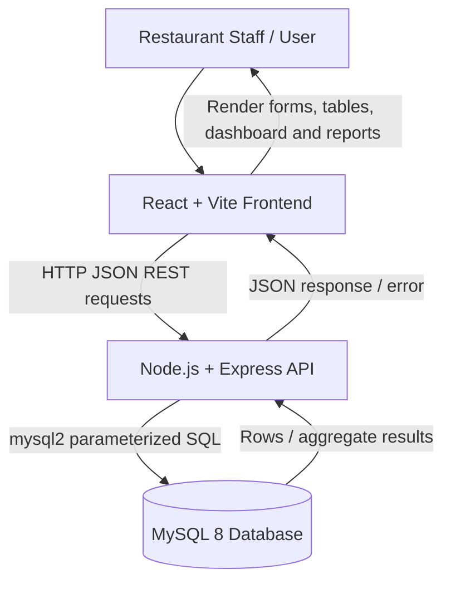

# System Architecture

Frontend forms call the REST API. Express routes dispatch to controllers. Controllers validate entity names and permitted columns, execute parameterized SQL through `mysql2`, and return JSON. MySQL enforces primary keys, foreign keys, uniqueness, nullability, defaults and check constraints. A centralized error handler converts common database errors into readable HTTP responses.
