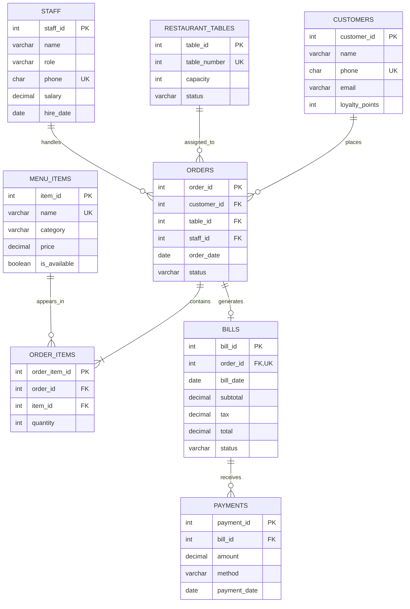

# Entity Relationship Diagram

Notes: Customer is optional on an order for walk-in transactions. An order may have zero or one bill. A bill may have multiple payment records (e.g. split payments). Every order has one or more order-item lines in the intended business workflow; the database FK ensures each line references an existing order and menu item.
